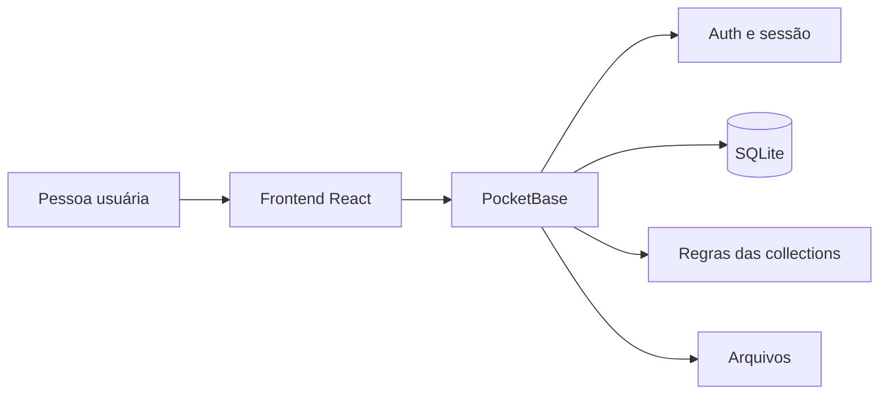
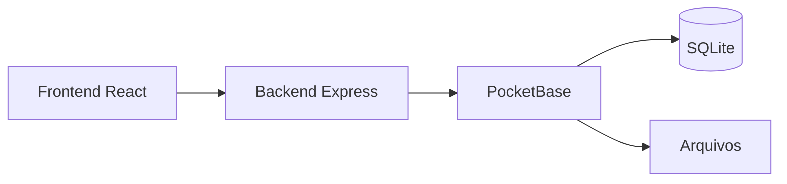

# Arquitetura

Esta arquitetura representa o uso do PocketBase como camada de autenticação, persistência e armazenamento.

## Visão do sistema

Opcionalmente, o backend Express pode permanecer como camada intermediária:

## Componentes

- **Frontend**: interfaces React organizadas em áreas administrativa e de clientes.
- **PocketBase**: API REST, autenticação, realtime, regras de acesso e armazenamento.
- **Collections**: estrutura equivalente às tabelas usadas pela aplicação.
- **Hooks**: regras executadas após eventos do servidor, como criação de usuário.
- **Migrações**: alterações versionadas do schema PocketBase.
- **Backend Express**: camada existente para regras de negócio, e-mail e integração, quando necessária.

## Conversão do Supabase

O schema foi convertido a partir da estrutura PostgreSQL/Supabase:

- UUIDs e IDs numéricos são representados conforme o modelo PocketBase.
- Chaves estrangeiras foram convertidas em campos `relation`.
- `jsonb` foi convertido para `json`.
- Datas PostgreSQL foram convertidas para campos `date`.
- Arquivos passaram a usar collection `storage_files` ou campos `file` nativos.
- Políticas RLS devem ser recriadas como regras das collections.
- Funções RPC e triggers não são importados automaticamente.
